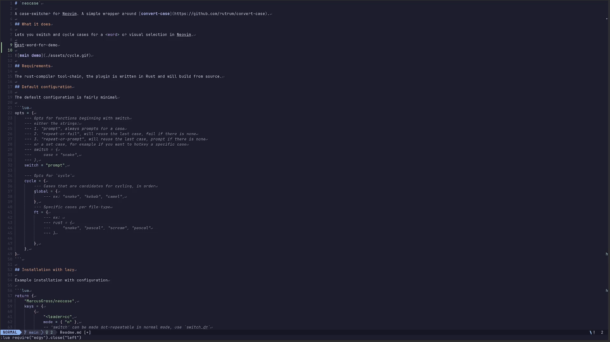

# `neocase`

A case-switcher for Neovim. A simple wrapper around [convert-case](https://github.com/rutrum/convert-case).

## What it does

Lets you switch and cycle cases for a <word> or visual selection in Neovim.



## Requirements

The rust-compiler tool-chain, the plugin is written in Rust and will build from source.

## Default configuration

The default configuration is fairly minimal

```lua
opts = {
    --- Opts for functions beginning with switch
    --- either the strings:
    --- 1. "prompt", always prompts for a case
    --- 2. "repeat-or-fail", will reuse the last case, fail if there is none
    --- 3. "repeat-or-prompt", will reuse the last case, prompt if there is none
    --- or a set case, for example if you want to hotkey a specific case
    --- switch = {
    ---     case = "snake",
    --- },
    switch = "prompt",

    --- Opts for `cycle`
    cycle = {
        --- Cases that are candidates for cycling, in order
        global = {
            --- ex: "snake", "kebab", "camel",
        },
        --- Specific cases per file-type
        ft = {
            --- ex: 
            --- rust = {
            ---     "snake", "pascal", "scream", "pascal"
            --- }

        },
    },
}
```

## Installation with lazy

Example installation with configuration

```lua
return {
    "MarcusGrass/neocase",
    keys = {
        {
            "<leader>cc",
            mode = { "n" },
            -- 'switch' can be made dot-repeatable in normal mode, use `switch_dr`
            function()
                return require("neocase").switch_dr()
            end,
            expr = true,
        },
        {
            "<leader>cc",
            mode = { "v" },
            function()
                require("neocase").switch()
            end,
        },
        {
            "<leader>cs",
            mode = { "n", "v" },
            function()
                require("neocase").cycle()
            end,
        },
    },
    opts = {
        cycle = {
            global = {
                "snake",
                "kebab",
                "pascal",
                "scream",
                "camel",
            },
            ft = {
                rust = {
                    "snake",
                    "pascal",
                    "scream",
                },
            },
        },
    },
}
```

## Available cases

Since this just wraps [convert-case](https://github.com/rutrum/convert-case), 
any cases from there could be added trivially, currently these cases are implemented:

    1. snake
    2. camel
    3. kebab
    4. pascal
    5. scream
    6. ada
    7. cobol
    8. flat
    9. train


## I don't want to a rust tool-chain

You could probably pretty trivially write a plugin in `lua` using the [ccase-cli](https://github.com/rutrum/ccase) which uses the same backing library, this code is always available if you 
want an implementation guide.  

## Quirks

There are some quirks

### Does not work with multi-line visual selections

The reason is that I didn't bother implementing it, because I saw 
no real reason for doing it.  

### Case-cycling always ends in a lowest-to-highest column visual selection of the changed work

The reason for this is fairly interesting, words can be cycled or switched from normal-mode 
because of vim's `expand("<word>")`. However, when the case is switched vim's definition of a 
<word> will differ from `convert-case`'s definition. 

Ex: 

```

hello_there -> 'hello-there' (snake to kebab)
hello-there -> 'Hello-there' (kebab to pascal, should have been 'HelloThere')

```
Additionally, a reversed visual selection (selected back to front within the row), is 
impossible (as far as I could find out) to move the right-anchor from. 
Since word-length can change when switching case, the anchor needs to be moved, 
therefore default behavior is to flip the direction of reversed visual selections.  

## License

This project is licensed under the Apache 2.0-license [see it here](./LICENSE).  

